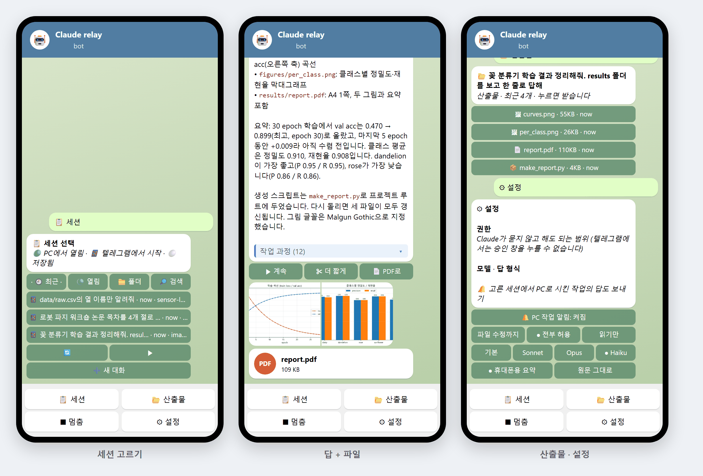

# Claude Code 텔레그램 릴레이

[English](README.md) · **한국어**

내 텔레그램 봇으로 휴대폰에서 PC의 Claude Code 세션과 대화합니다.
- 서버도, 관제도, 열어 둘 포트도 필요 없습니다. Claude CLI를 직접 실행합니다(`claude -p --resume <세션>`, 메시지 하나에 한 턴).
- 세션 목록은 `~/.claude`에서 읽습니다.
- npm 패키지 없이 동작합니다. Node.js 18 이상과 Claude Code만 있으면 됩니다.

> 함께 쓰면 좋은 도구: [Agent CLI Hub](https://github.com/JaekunE2/agent-cli-hub)(모든 에이전트 세션을 한 웹 페이지에서 관제). 릴레이는 이것 없이도 동작합니다.

## 기능

| | |
|---|---|
| **📋 버튼으로 세션 고르기** | **최근**, **열림**(지금 PC 터미널에서 열려 있는 세션), **폴더**, **검색** 탭이 있습니다. 검색은 제목과 지금까지 입력한 모든 메시지에서 찾습니다. **➕ 새 대화**로 폴더를 골라 새로 시작할 수도 있습니다. |
| **📌 세션 카드** | 고른 세션이 채팅 맨 위에 고정됩니다. 최근 대화, 산출물, 세션 바꾸기 버튼이 함께 있습니다. |
| **💬 메시지** | 고른 세션이 메시지를 이어서 처리합니다. 일하는 동안 **진행 카드**에 경과 시간, 지금 하는 단계(💻 Bash, ✏️ Write, 🔎 Grep…), ⏹ 버튼이 표시됩니다. |
| **📱 휴대폰에 맞춘 답** | 세션에게 짧게 답하라고 함께 전합니다(결론 먼저, 넓은 표 대신 목록). Markdown은 텔레그램 서식으로, 표는 행마다 카드로 바꿉니다. 긴 답은 한 메시지 안에서 **◀ 1/3 ▶**로 넘깁니다. 거친 단계는 접히는 인용으로 넣습니다. 답 아래에는 **빠른 답장** 버튼(▶ 계속 · ✂ 더 짧게 · 📄 PDF로)이 있습니다. |
| **📷 사진·파일 보내기** | 사진(앨범 포함), 문서, 음성, 영상을 보내면 `data/inbox`에 저장하고 세션에 경로를 넘깁니다. 캡션이 요청이 됩니다. |
| **📂 산출물 받기** | 그 턴에 세션이 만든 PDF·그림·영상·문서가 답과 함께 옵니다. 그림 여러 장은 앨범 하나로 옵니다. **📂 산출물** 버튼으로 최근 결과를 골라 받을 수도 있습니다. |
| **🔔 PC에서 시킨 작업** | 켜 두면, 같은 세션에서 PC로 시킨 작업의 답도 보내 줍니다. |
| **⚙ 설정** | 알림, **권한**(파일 수정까지 / 전부 / 읽기만), 모델(기본 / Sonnet / Opus / Haiku), 답 형식을 버튼 한 번으로 바꿉니다. |
| **🌐 한국어 / English** | 텔레그램 언어를 따릅니다. `"lang"`으로 바꿀 수 있습니다. |

**PC에서 열려 있는 세션**은 두 곳에서 동시에 쓰지 않습니다. 첫 메시지부터 같은 기록을 가진 **사본(포크)**으로 이어 가고, 그 뒤로는 사본에서 계속합니다.

## 설치 (2분)

코드 받기: `git clone https://github.com/JaekunE2/claude-telegram-relay` (또는 **Code → Download ZIP** 후 압축 풀기)

1. 텔레그램에서 **[@BotFather](https://t.me/BotFather)**를 열고 `/newbot`을 보냅니다. 이름과 아이디(`bot`으로 끝남)를 정한 뒤 **토큰**을 복사합니다.
2. PC에서 **`setup.bat`**을 실행하고 토큰을 붙여 넣습니다.
   - `t.me/<내 봇>?start=<코드>` 링크가 나옵니다. 휴대폰에서 열고 **시작**을 누르면 *내* 텔레그램 계정이 연결됩니다. 다른 사람은 이 봇을 쓸 수 없습니다.
   - Claude가 묻지 않고 해도 되는 범위를 고릅니다. 텔레그램에서는 승인 창을 누를 수 없기 때문입니다.
     - **파일 수정까지**(`acceptEdits`, 기본)
     - **전부**(`bypassPermissions`)
     - **읽기만**(`plan`)
   - 로그온 때 자동으로 켤지 묻고, 바로 시작합니다.
3. 텔레그램에서 **📋 세션**을 눌러 세션을 고릅니다.

macOS나 Linux에서는 `node relay.js setup`을 실행한 뒤 `node relay.js`로 켭니다. 프록시가 필요한 망이면 `setup.bat --proxy http://주소:포트`로 실행합니다.

**에이전트에게 맡기기**: Claude Code나 Codex에 *"https://github.com/JaekunE2/claude-telegram-relay 를 받아 설치하고, 텔레그램에서 내가 할 일을 알려줘"*라고 하면 `setup.bat`을 실행합니다. 사용자는 토큰을 붙여 넣고 시작을 누르기만 하면 됩니다.

## 명령

| | |
|---|---|
| `setup.bat` | 봇 연결 (다시 실행하면 다른 텔레그램 계정 추가, `--new`는 새 토큰) |
| `start.bat` / `stop.bat` | 백그라운드로 시작 / 멈춤 |
| `install-autostart.ps1` / `uninstall-autostart.ps1` | 로그온 자동 시작 (현재 사용자) |
| `data\relay.log` | 로그 |

## 설정: `data/config.json`

`setup.bat`이 만듭니다.

| 키 | 기본값 | |
|---|---|---|
| `token`, `allowed` | | 봇 토큰, 사용할 수 있는 텔레그램 사용자 ID |
| `lang` | 텔레그램 언어 | `ko` 또는 `en` |
| `permissionMode` | `acceptEdits` | `acceptEdits`, `bypassPermissions`, `plan` (⚙ 설정에서도 변경) |
| `model` | Claude Code 기본 | `sonnet`, `opus`, `haiku` 또는 모델 ID |
| `style` | `phone` | `raw`면 "휴대폰용으로 짧게" 안내를 붙이지 않음 |
| `autoSendFiles` | 6 | 한 턴에 자동으로 보내는 산출물 수 |
| `maxTurnMinutes` | 60 | 이보다 오래 걸리는 턴은 멈춤 |
| `proxy` | | 프록시가 필요한 망에서 `http://주소:포트` |
| `claude` | PATH에서 찾음 | Claude CLI 경로 |

## 보안

- 연결 코드로 연결한 텔레그램 계정에만 답합니다. 다른 사람의 메시지는 무시하고 로그에 남깁니다.
- 봇 토큰과 허용 목록은 `data/config.json`(git 제외)에 있습니다. 토큰은 비밀번호처럼 다루고, 새어 나갔다면 BotFather의 `/revoke`로 바꾸세요.
- 세션이 할 수 있는 일은 `permissionMode`로 제한됩니다. 휴대폰에서 보낼 수 있는 모든 지시를 믿을 수 있을 때만 기본값보다 넓히세요.
- 파일은 다음 경우에만 나갑니다.
  - 그 턴에 세션이 쓰거나 답에서 경로를 말한 파일
  - **📂 산출물**에서 직접 누른 파일

  텔레그램 봇은 50MB까지 보내고 20MB까지 받습니다.

## 테스트

`node test/e2e.js <빈 폴더> [모델] [en|ko]`는 텔레그램 API를 흉내 내는 로컬 서버(`test/mock-telegram.js`)와 실제 Claude CLI로 릴레이를 시험합니다. 확인하는 항목은 다음과 같습니다.
- 탭·검색으로 세션 고르기, 고정 카드, 진행 카드
- 답과 페이지 넘김, 앨범, PDF, 사진 보내기
- 산출물, 설정, PC 작업 알림, 멈춤
