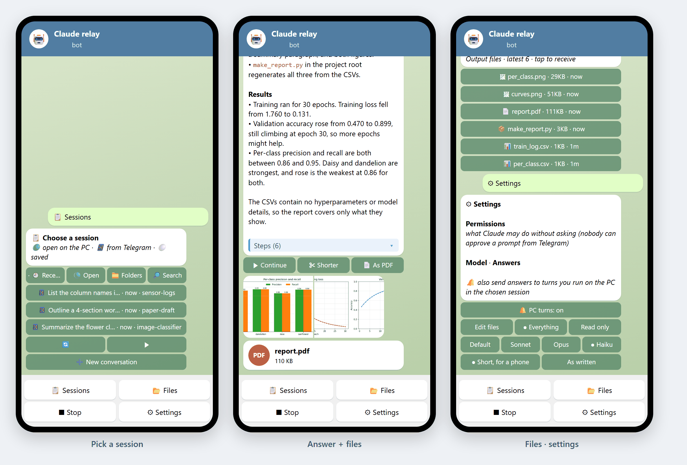

# Telegram Relay for Claude Code

**English** · [한국어](README.ko.md)

Talk to the Claude Code sessions on your PC from your phone, through your own Telegram bot.

- No server, no hub, and no open ports. It runs the Claude CLI directly: `claude -p --resume <session>`, one turn per message.
- It reads your sessions from `~/.claude`.
- No npm packages. You need Node.js 18+ and Claude Code.

> Also part of a bigger toolkit: [Agent CLI Hub](https://github.com/JaekunE2/agent-cli-hub) — one web page for all your agent sessions. The relay does not need it.

## What it does

| | |
|---|---|
| **📋 Pick a session with buttons** | Tabs: **Recent**, **Open** (sessions open in a terminal on the PC right now), **Folders**, **Search**. Search matches titles and every prompt you typed. **➕ New conversation** starts one in a folder. |
| **📌 Session card** | The chosen session is pinned at the top of the chat, with buttons for its recent messages, its files, and changing session. |
| **💬 Messages** | The session continues with your message. A **progress card** shows the elapsed time, the steps it is taking (💻 Bash, ✏️ Write, 🔎 Grep…) and a ⏹ button. |
| **📱 Answers made for a phone** | The session is asked to answer short: conclusion first, lists rather than wide tables. Markdown becomes Telegram formatting, and tables become one card per row. Long answers page with **◀ 1/3 ▶** inside the same message. The steps taken are folded into an expandable quote. **Quick replies** under each answer: ▶ Continue · ✂ Shorter · 📄 As PDF. |
| **📷 Photos and files in** | Send photos (albums too), documents, voice or video. They are saved in `data/inbox` and the session gets their paths. The caption is the request. |
| **📂 Files out** | PDFs, figures, videos and documents the session wrote in that turn arrive with the answer. Several pictures come as one album. **📂 Files** lists the session's recent outputs; tap one to receive it. |
| **🔔 Turns you run on the PC** | Optional: when you work in the same session at the PC, its answers are forwarded too. |
| **⚙ Settings** | Notifications, **permissions** (edit files / everything / read only), model (default / Sonnet / Opus / Haiku), answer style. Each is one tap. |
| **🌐 English / 한국어** | Follows your Telegram language; set `"lang"` to override. |

**Sessions open on the PC.** When a session is open in a terminal, the relay never writes into it at the same time. Your first message continues it as a **copy (fork)** with the same history, and the relay carries on there.

## Setup (about 2 minutes)

Get the code: `git clone https://github.com/JaekunE2/claude-telegram-relay` (or **Code → Download ZIP** and unzip).

1. In Telegram, open **[@BotFather](https://t.me/BotFather)** and send `/newbot`. Choose a name and a username ending in `bot`, then copy the **token**.
2. On the PC, run **`setup.bat`** and paste the token.
   - It shows a link, `t.me/<your bot>?start=<code>`. Open it on your phone and press **START**: that links *your* Telegram account. Nobody else can use the bot.
   - It asks what Claude may do without asking. Nobody can approve a permission prompt from Telegram, so choose one of:
     - **edit files** (`acceptEdits`, the default)
     - **everything** (`bypassPermissions`)
     - **read only** (`plan`)
   - It offers to start the relay at logon, then starts it.
3. In Telegram, tap **📋 Sessions** and pick one.

On macOS or Linux, use `node relay.js setup` and then `node relay.js`.

Behind a proxy, run `setup.bat --proxy http://host:port`.

**Let an agent install it.** You can ask Claude Code or Codex: *"Clone https://github.com/JaekunE2/claude-telegram-relay, run its setup and tell me what to do in Telegram."* It runs `setup.bat`. You only paste the token and press START.

## Commands

| | |
|---|---|
| `setup.bat` | link a bot (run again to add another Telegram account; `--new` for a new token) |
| `start.bat` / `stop.bat` | start in the background / stop |
| `install-autostart.ps1` / `uninstall-autostart.ps1` | start at logon (current user) |
| `data\relay.log` | log |

## Configuration: `data/config.json`

`setup.bat` writes this file.

| key | default | |
|---|---|---|
| `token`, `allowed` | | bot token; Telegram user ids allowed to use it |
| `lang` | Telegram language | `en` or `ko` |
| `permissionMode` | `acceptEdits` | `acceptEdits`, `bypassPermissions`, `plan` (also in ⚙ Settings) |
| `model` | Claude Code's default | `sonnet`, `opus`, `haiku`, or a full model id |
| `style` | `phone` | `raw` = no "answer for a phone" note |
| `autoSendFiles` | 6 | output files sent automatically per turn |
| `maxTurnMinutes` | 60 | a turn running longer is stopped |
| `proxy` | | `http://host:port` for networks that need it |
| `claude` | found on PATH | path to the Claude CLI |

## Security

- Only the Telegram accounts linked with the pairing code are answered. Everyone else is ignored and logged.
- The bot token and the allow-list live in `data/config.json` (git-ignored). Treat the token like a password; if it leaks, use `/revoke` in BotFather.
- What a session may do is limited by `permissionMode`. Keep the default unless you trust everything you might send from your phone.
- Files go out only when a turn wrote them or named them, or when you tap them in **📂 Files**. Telegram limits bots to 50 MB out and 20 MB in.

## Test

`node test/e2e.js <empty folder> [model] [en|ko]` drives the relay against a local stand-in for the Telegram API (`test/mock-telegram.js`) and the real Claude CLI. It covers:
- picking with tabs and search, the pinned card, the progress card;
- answers, paging, the album and PDF, photos in, files, settings;
- a PC turn, and stop.
